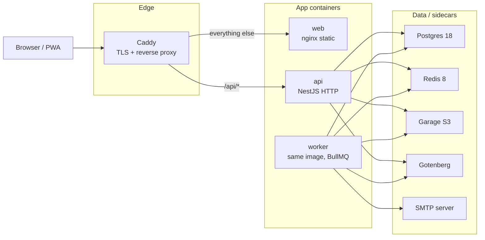

# Architecture

One-page overview of the production-like stack. No business domains yet — only the platform shells.

## Process roles

| Process | Image | Command | Role |
|---------|-------|---------|------|
| migrate | `ddcrm-api` | `prisma migrate deploy` | One-shot schema apply |
| api | `ddcrm-api` | `node dist/main.js` | HTTP, enqueue jobs, Bull Board |
| worker | `ddcrm-api` | `node dist/worker.js` | Consume queues (email, pdf, …) |
| web | `ddcrm-web` | nginx | Built SPA + PWA assets |
| caddy | `caddy` | Caddyfile | Only published ports (80/443) |

Dev differs: Vite on `:5173`, API on `:3000`, Mailpit instead of real SMTP, Garage `--single-node --default-bucket`. See [DEPLOYMENT.md](./DEPLOYMENT.md) and the root README.
